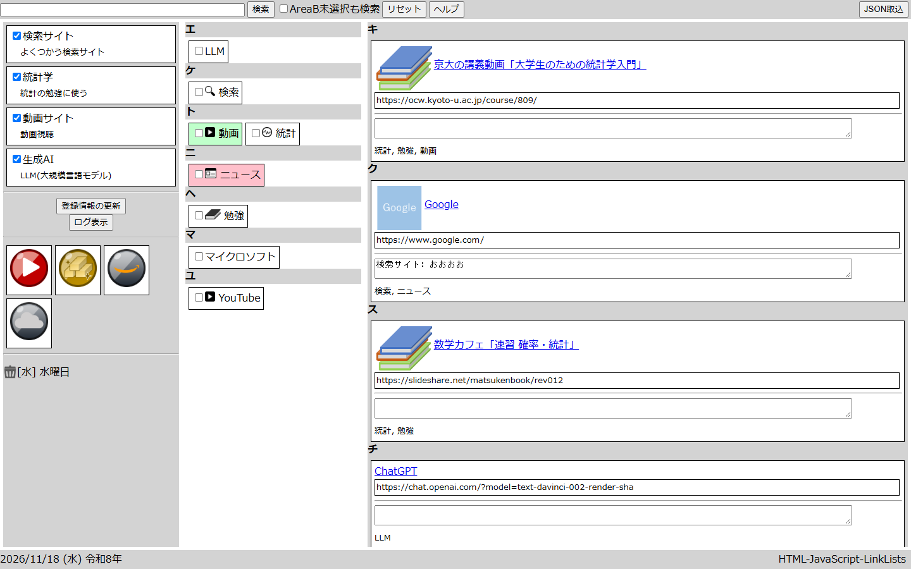

# リンクリスト

リンクリストは、増え続けるWebサイトやローカルファイルのリンクを、検索とカテゴリで素早く見つけるための無料Webアプリです。

インストールやWebサーバーは不要です。ファイル一式をダウンロードし、`index.html` をブラウザで開くだけで利用できます。登録したデータはブラウザのWeb Storageに保存されます。



## こんな人におすすめ

- 仕事、開発、学習などのリンクが増え、必要なページを探すのに時間がかかる
- リンクをカテゴリやメモ付きで整理したい
- Webサイトだけでなく、ローカルのファイルやフォルダもまとめたい
- アカウント登録やサーバーの準備をせずに使いたい
- 登録データをJSONファイルとして自分で保管、移行したい

## 主な機能

- 名前、URL、カテゴリ、メモを対象にしたキーワード検索
- スペース区切りによるAND検索
- カテゴリやリンク集ごとの絞り込み
- リンクの新規作成、編集、表示・非表示の切り替え
- JSONファイルの取込、出力、上書き、マージ
- 操作ログの表示とCSV出力
- アイコンを使った検索
- 日付、曜日に応じたメッセージ表示

## 3分で使い始める

### 1. ダウンロードする

このリポジトリの `Code` → `Download ZIP` を選び、ダウンロードしたZIPファイルを展開します。

Gitを利用する場合は、次のコマンドでも取得できます。

```text
git clone https://github.com/zgw426/HTML-JavaScript-LinkLists.git
```

### 2. 起動する

展開したフォルダ内の `index.html` をChrome、Edge、Braveなどのブラウザで開きます。

初回起動時は、まだリンク情報が登録されていないため、一覧が空の場合があります。

### 3. サンプルデータを取り込む

1. 画面上部の `JSON取込` を押します。
2. `links_51.json` から `links_60.json` のうち、試したいファイルを選びます。複数選択もできます。
3. 初回は、選択されている `新規情報として取り込む` のまま進めます。
4. 取込予定を確認し、`取込実行` を押します。
5. 初回取込では、追加されたリンク集が自動的に選択されます。右側が空の場合は、画面左側のチェックボックスをオンにします。

例えば、次のサンプルが含まれています。

| ファイル | 内容 |
|---|---|
| `links_51.json` | 検索サイト |
| `links_52.json` | 買い物 |
| `links_54.json` | 統計学 |
| `links_55.json` | 動画サイト |
| `links_56.json` | SNS |
| `links_60.json` | 生成AI |

### 4. 検索する

画面左側で検索したいリンク集にチェックを入れ、画面上部の検索欄に、例えば `動画` や `検索 ニュース` と入力して `検索` を押します。

複数の単語をスペースで区切ると、すべての単語に一致するリンクだけが表示されます。

### 5. 自分のリンクを登録する

1. 左側の `登録情報の更新` を押します。
2. 管理画面右上の `新規作成` を押します。
3. Title、リンク名、URL、カテゴリ、メモなどを入力します。
4. `Web Storage更新` を押します。

より詳しい操作は [USER_GUIDE.md](USER_GUIDE.md) を参照してください。

## データの保存とバックアップ

登録したリンク、設定、操作ログは、`index.html` を開いたブラウザのWeb Storage（Local Storage）に保存されます。

- アカウント登録はありません。
- アプリ本体は、登録データを外部サーバーへ送信しません。
- 別のブラウザ、別のブラウザプロファイル、別のPCとは自動で共有されません。
- ブラウザのサイトデータを削除すると、登録データも削除される場合があります。

大切なデータは、管理画面の `JSON出力` で定期的にバックアップしてください。別の環境では、出力したJSONファイルを `JSON取込` から取り込めます。

## JSON取込方法の違い

| 方法 | 動作 |
|---|---|
| 新規情報として取り込む | 空いているIDを自動で割り当て、別のリンク集として追加します |
| 上書き | 同じ内部IDの登録データを、取り込むデータで置き換えます |
| マージ | 既存データと取り込むデータを結合します |
| このファイルを取り込まない | そのファイルを取込対象から外します |

上書きは既存データを置き換えるため、必要に応じて事前にJSON出力でバックアップしてください。

## よくある質問

### インストールは必要ですか？

必要ありません。ZIPファイルを展開し、`index.html` をブラウザで開くだけです。

### 起動してもリンクが表示されません

初回起動時はリンク情報が未登録です。`JSON取込` から同梱の `links_51.json` などを取り込んでください。

### データはどこに保存されますか？

使用しているブラウザのWeb Storageに保存されます。元のJSONファイルへ自動的に書き戻されるわけではありません。

### 別のPCやブラウザへ移行できますか？

できます。現在の環境で `JSON出力` を実行し、移行先でそのファイルを `JSON取込` してください。

### ブラウザのブックマークを自動的に読み込めますか？

現在は対応していません。リンクリスト形式のJSONファイルを取り込むか、管理画面から登録します。

### Webサイト以外も登録できますか？

ローカルファイルやフォルダのパスもURL欄へ登録できます。ブラウザのセキュリティ設定によっては、リンクから直接開けない場合があります。

### データが消えないようにするには？

定期的に `JSON出力` でバックアップしてください。ブラウザのサイトデータ削除やプロファイル削除を行う前にも出力を推奨します。

### 無料で利用できますか？

はい。MIT Licenseで公開しています。詳しくは [LICENSE](LICENSE) を参照してください。

## ファイル構成

| ファイル | 説明 |
|---|---|
| `index.html` | アプリ本体 |
| `help.html` | アプリ画面から開ける初心者向けヘルプ |
| `USER_GUIDE.md` | 詳細な操作説明 |
| `links_51.json` ～ `links_60.json` | 動作確認用のサンプルリンク集 |
| `function_enhancement.json` | アイコン検索、日付・曜日表示などの設定例 |
| `icon/` | リンクや機能で使用する画像 |
| `icon_catalog.json.js` | 管理画面に表示するアイコン一覧 |
| `area_c_icon_mapinfo.js` | カテゴリアイコンの対応設定 |
| `make_json_js.html` | JSON編集を補助するツール |

## 詳細情報

- [ブラウザで開ける初心者向けヘルプ](help.html)
- [詳しい操作説明](USER_GUIDE.md)
- [旧版の技術資料](README_type01.md)
- [紹介動画（YouTube）](https://www.youtube.com/watch?v=x7VU7s56g4U)

## ライセンス

[MIT License](LICENSE)
